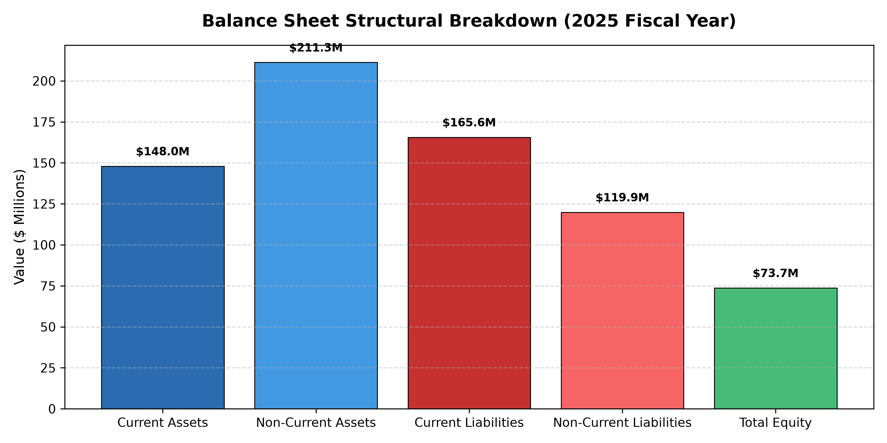

# Financial Statement Auditor

This Python project reads raw text financial statements, extracts the metrics, and checks if the balance sheet balances correctly.

## Features
* **Text Parser:** Reads financial rows from a text file and extracts values. It handles rows that contain commas in their names, such as "Selling, general and administrative".
* **Duplicate Handler:** Correctly identifies duplicate row names, like short-term vs long-term marketable securities, based on the order they appear in the file.
* **Accounting Audit:** Automatically calculates totals from scratch and verifies that total assets equal total liabilities plus equity.

## Requirements
* Python 3.10 or higher
* NumPy

## How to Run

1. Activate your virtual environment and install the requirements:
```bash
source .venv/bin/activate
pip install numpy
```

2. Run the main script to start the parsing and audit check:
```bash
python3 engine.py
```

```
## Visual Data Verification
Below is the structural breakdown generated dynamically from the text parsing system:


